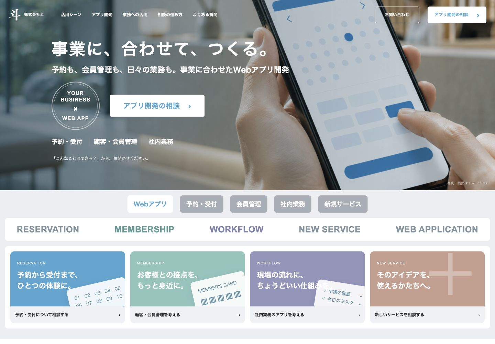
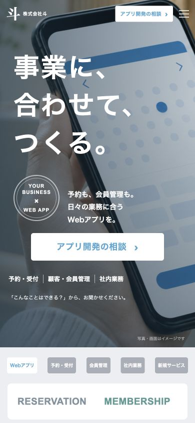

# 株式会社斗｜Webアプリ開発LP 確認用

**[確認用LPを開く](https://hoshizaemonn.github.io/tou-app-lp-preview/)**

鈴木さん確認用の制作案です。フォームは確認画面までで、問い合わせの送信は行いません。

## ご確認いただきたい点

- 参考サイト [Yappli](https://yapp.li/) を基準にした構図、画像と文字の比率、余白、ページ全体のリズム
- 株式会社斗のサービスとしてのコピーと相談テーマ
- PC・スマートフォンでの見え方と、相談ボタン・メニューの使いやすさ

## 実装したページの実画面

### PC（1440px幅）

[PC全体画像](screenshots/lp-pc-full.jpg)

### スマートフォン（390px幅）


[スマートフォン全体画像](screenshots/lp-mobile-full.jpg)

## 再現した点と変更した点

全面ビジュアルのファーストビュー、固定ヘッダー、端末群、大きな番号付きセクション、淡灰色のパネル、青い相談エリア、黒いフッターを基準に制作しています。

他社の文章・素材・ソースコードは使わず、独自素材に置き換えています。実績や受賞の表示は相談テーマへ、ニュース・資料は相談のきっかけとFAQへ変更しました。動画は独自写真の緩やかな動きに変更しています。

写真はAI生成、画面は架空のUIです。実在の社員・顧客・開発実績・提供機能を表していません。未確認の価格・納期・成果は掲載していません。

## 動作確認

ChromeのPC・スマートフォン幅で全体を確認。375・390・768・1024・1440pxでページ全体の横スクロールなし。メニュー・テーマ切替・FAQ・相談フォームの確認/戻る/閉じるを確認済みです。スマートフォン実機での検証は未実施です。

HTML/CSS/JavaScriptの静的サイトです。`index.html` をブラウザで開くか、次のコマンドでローカル表示できます。

```sh
python3 -m http.server 4173 --bind 127.0.0.1
```

[実装の詳細](IMPLEMENTATION.md) ／ [画像素材の作成記録](ASSETS.md)

このリポジトリと確認用LPはインターネット公開されています。noindex・nofollow・robots.txtを設定していますが、アクセス制限ではありません。
